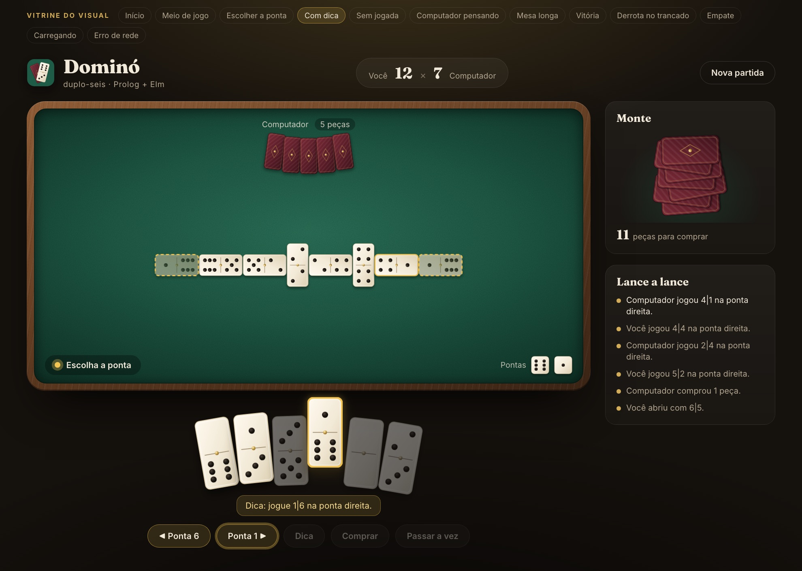

# Dominó em Prolog + Elm

Trabalho final de Paradigmas de Programação: um jogo de dominó (duplo-seis) contra o computador.
As regras do jogo ficam em **Prolog**, a interface em **Elm**, e um backend em **Python/FastAPI** faz a ponte entre os dois.

> Projeto em construção. As partes já prontas estão marcadas na seção [Andamento](#andamento).

## Arquitetura

```
Navegador (Elm)  <--HTTP/JSON-->  FastAPI (Python)  <--janus-->  SWI-Prolog
   avaliado                        não avaliado                   avaliado
```

- **Prolog** (`backend/prolog/`): toda a lógica do jogo, como distribuir as peças, validar jogadas, comprar, passar a vez, detectar o fim e escolher a jogada do computador.
- **FastAPI** (`backend/app/`): recebe as requisições do navegador, chama o Prolog pelo [janus](https://www.swi-prolog.org/pldoc/man?section=janus) e devolve JSON (veja [API](#api-fastapi)). Também serve a pasta `frontend/`, então o jogo e a API ficam na mesma origem.
- **Elm** (`frontend/src/`): a tela do jogo, com a mesa, a mão do jogador e a do oponente. O desenho fica em `View.elm` e `style.css` (veja [Visual](#visual)).
  A lógica da tela fica em `Main.elm`: seleção de peça e ponta, turnos e mensagens de erro. O `Main` guarda o último estado que o backend confirmou e segue o `turn` dele, sem repetir as regras do Prolog.

## Representação dos dados

O janus só converte listas, números e átomos. Termos compostos como `peca(3,5)` não passam, e por isso tudo é representado com listas e átomos.

| Conceito | Representação | Exemplo |
|---|---|---|
| Peça (na mão ou no monte) | lista `[A,B]` com `A =< B` | `[3,5]` |
| Mão / monte | lista de peças | `[[0,1],[2,2],[3,6]]` |
| Mesa | peças da ponta esquerda para a direita, cada uma virada para encostar na vizinha | `[[6,5],[5,2],[2,2]]` (pontas 6 e 2) |
| Lado da jogada | átomo `left` ou `right` | `right` |
| Jogada | lista `[Peça, Lado]` | `[[2,4], right]` |
| Turno | átomo `player` ou `opponent` | `player` |

Estado da partida trocado com o frontend:

```json
{
  "player_hand":   [[0,1],[2,4]],
  "opponent_hand": [[3,3],[1,6]],
  "table":         [[6,5],[5,2]],
  "boneyard":      [[0,0],[4,5]],
  "turn":          "player"
}
```

### Rotas HTTP

Proposta da parte 5, já usada pelo `Main.elm` (detalhes em `frontend/src/Api.elm`). Todas são `POST` e o estado vai e volta inteiro: o backend não guarda nada entre uma chamada e outra.

| Rota | Corpo | Resposta |
|---|---|---|
| `/new-game` | vazio | `{"state", "start_piece"}` |
| `/play` | `{"state", "action"}` | `{"state", "result"}` |
| `/opponent-move` | `{"state"}` | `{"state", "result"}` |
| `/hint` | `{"state"}` | `{"hint"}` |

- `action` e `hint` têm o formato do `hint/4`: `[[2,4],"right"]`, `"draw"` ou `"pass"`. Comprar e passar vão pela rota `play`.
- `start_piece` é a `StartPiece` do `new_game/5`. Com a mesa vazia, a tela só deixa jogar essa peça.
- `result` é `null` enquanto há jogo e, no fim, `{"winner": "player", "points": 14}` (o `game_over/6`).
- `opponent-move` faz a vez inteira do computador: compra com `draw_until_playable/6` e joga com `choose_move/3`, ou passa. O `turn` devolvido já é o de quem joga em seguida.
- Jogada inválida responde HTTP 400 com `{"detail": "frase para o jogador"}`, e a frase aparece na tela.

## Predicados Prolog

Todos ficam no módulo `domino` (`backend/prolog/domino.pl`).

### Preparação da partida

| Predicado | O que faz |
|---|---|
| `all_pieces(-Pieces)` | Gera as 28 peças do duplo-seis. |
| `shuffle(+Pieces, -Shuffled)` | Embaralha as peças. |
| `deal(+Shuffled, -Player, -Opponent, -Boneyard)` | Dá 7 peças para cada jogador e deixa 14 no monte. |
| `piece_rank(+Piece, -Rank)` | Força da peça: buchas valem mais e, entre as outras, vale a maior soma. |
| `starter(+Player, +Opponent, -Turn, -Piece)` | Decide quem começa e com qual peça. |
| `new_game(-Player, -Opponent, -Boneyard, -Turn, -StartPiece)` | Monta uma partida completa. |

### Regras das jogadas

| Predicado | O que faz |
|---|---|
| `table_ends(+Table, -Left, -Right)` | Pontas da mesa. Falha com a mesa vazia. |
| `fits(+Piece, +Table, ?Side)` | Verdadeiro se a peça encaixa naquele lado. Na mesa vazia, o lado é `right`. |
| `valid_moves(+Hand, +Table, -Moves)` | Todas as jogadas possíveis como `[Peça, Lado]`. |
| `playable_pieces(+Hand, +Table, -Pieces)` | Peças da mão que podem ser jogadas. |
| `play_piece(+Piece, +Side, +Hand, +Table, -NewHand, -NewTable)` | Joga a peça: tira da mão, vira se preciso e coloca na mesa. Aceita `[5,3]` ou `[3,5]`. Falha se a jogada for inválida. |
| `draw(+Boneyard, +Hand, -NewBoneyard, -NewHand)` | Compra uma peça do monte. Falha com o monte vazio. |
| `draw_until_playable(+Hand, +Table, +Boneyard, -NewHand, -NewBoneyard, -Drawn)` | Compra até ter jogada ou o monte acabar. `Drawn` lista as peças compradas. |
| `can_pass(+Hand, +Table, +Boneyard)` | Só pode passar quem não tem jogada e não tem mais o que comprar. |
| `next_turn(+Turn, -Next)` | Alterna entre `player` e `opponent`. |

### Fim de jogo

| Predicado | O que faz |
|---|---|
| `domino_out(+Hand)` | Verdadeiro se a mão está vazia (o jogador bateu). |
| `blocked(+Player, +Opponent, +Table, +Boneyard)` | Jogo trancado: monte vazio e nenhum dos dois tem jogada. |
| `hand_points(+Hand, -Points)` | Soma dos pontos da mão. |
| `game_over(+Player, +Opponent, +Table, +Boneyard, -Winner, -Points)` | Falha enquanto há jogo. `Winner` é `player`, `opponent` ou `draw`. Na batida vence quem ficou sem peças; no trancado, quem tem menos pontos. O vencedor marca a soma da mão do perdedor (0 no empate). |

### Adversário e dica

| Predicado | O que faz |
|---|---|
| `move_score(+Move, +Hand, +Table, -Score)` | Nota da jogada: pontos da peça + 5 se for bucha + 2 por peça que continua jogável depois. |
| `choose_move(+Hand, +Table, -Move)` | Jogada do computador: a de maior nota. Falha se não houver jogada (aí compra com `draw_until_playable/6` ou passa). |
| `hint(+Hand, +Table, +Boneyard, -Hint)` | Dica para o jogador: `[Peça, Lado]`, `draw` (comprar) ou `pass` (passar). |

Exemplo no `swipl`:

```prolog
?- use_module(backend/prolog/domino).

?- valid_moves([[0,6],[2,4],[1,3]], [[6,5],[5,2]], Moves).
Moves = [[[0,6], left], [[2,4], right]].

?- play_piece([0,2], right, [[0,2]], [[6,5],[5,2]], Hand, Table).
Hand = [],
Table = [[6,5],[5,2],[2,0]].
```

## Visual



Conceito: **mesa de praça**. Feltro verde com borda de madeira, peças de marfim com pino de latão e luz quente vindo de cima. Nenhuma imagem é baixada: todas as peças (frente, costas, monte e logo) são SVG desenhado pelo próprio `View.elm`.

- **Cadeia em "cobra"**: a mesa vira fileiras que alternam de direção. Na virada, duas peças descem em pé, e as buchas ficam atravessadas, como numa mesa de verdade. Quando a mesa muda, as peças deslizam até o lugar novo, e a última jogada ganha um contorno dourado.
- **Escolha da ponta**: se a peça encaixa só numa ponta, um clique já joga. Se encaixa nas duas, aparecem "sombras" tracejadas onde ela pode entrar (e botões `◀ Ponta 6` / `Ponta 1 ▶` para quem usa teclado).
- **Mãos em leque**: as peças jogáveis sobem um pouco e as que não encaixam ficam apagadas. A mão do computador fica virada para baixo e só é revelada no fim, peça por peça.
- **Dica**: a peça, a ponta, o monte ou o botão de passar sugeridos pelo `hint/4` pulsam em dourado, com a frase da dica embaixo.
- **Fim de jogo**: um cartão diz se foi batida ou jogo trancado, os pontos e o que sobrou em cada mão. Na vitória, chovem pecinhas.
- Funciona no celular, com uma cobra mais estreita, e respeita `prefers-reduced-motion`.

### Contrato com a lógica da tela

`View.elm` não importa `Domino` nem `Main`. Ele recebe tudo pronto em `View.Props` e devolve as ações pelas funções de `View.Config`:

```elm
type alias Props =
    { playerHand : List Piece          -- Piece = ( Int, Int ), como [3,5]
    , opponentHand : List Piece        -- desenhada virada; revelada no fim
    , table : List Piece               -- mesma ordem do backend
    , boneyard : Int                   -- quantas peças no monte
    , status : Status                  -- Loading | PlayerTurn | OpponentTurn | Finished Winner Int
    , selected : Maybe Piece
    , hint : Maybe Hint                -- PlayHint Piece End | DrawHint | PassHint
    , lastPlayed : Maybe Piece
    , opening : Maybe Piece            -- StartPiece do new_game/5: com a mesa vazia, só ela entra
    , log : List String                -- lance a lance, o mais novo primeiro
    , score : { player : Int, opponent : Int }
    , error : Maybe String
    }

type alias Config msg =
    { onSelect : Maybe Piece -> msg    -- Nothing desfaz a seleção
    , onPlay : Piece -> End -> msg     -- End = LeftEnd | RightEnd (left / right)
    , onDraw : msg
    , onPass : msg
    , onHint : msg
    , onNewGame : msg
    }
```

No `Main.elm` basta converter o modelo para `Props` e chamar `View.view config (toProps model)`. O visual só usa as pontas da mesa (e a `opening`, com a mesa vazia) para destacar peças e desenhar as sombras: quem valida a jogada é o Prolog.

O botão "Passar a vez" fica liberado sempre que é a vez do jogador e a mesa não está vazia, mesmo tendo peça. Ele só fica em destaque quando não há outra saída. No jogo de verdade a API segue o `can_pass/3`: o passe com peça na mão ou com monte é recusado (422) com uma mensagem dizendo o motivo, que a tela mostra em `error`.

### Vitrine

`frontend/src/Preview.elm` mostra o visual sem precisar do backend.

- **Partida nova** é uma partida completa contra o computador, em turnos. As 28 peças são embaralhadas e cada um recebe 7. Quem tem a maior bucha abre com ela (sem bucha, abre a peça mais pesada), como no `starter/4`. Depois a vez alterna: o computador "pensa", compra até ter jogada (`draw_until_playable/6`) ou passa. A partida termina na batida ou no jogo trancado, como no `game_over/6`, e o placar vai somando.
- **Nível do computador**: o computador não usa inteligência artificial, só uma regra fixa para escolher a jogada.
  - Fácil: sorteia qualquer peça que encaixa.
  - Médio: joga a peça mais pesada.
  - Difícil: usa a mesma nota do `move_score/4` (pontos da peça, +5 se for bucha, +2 por peça que continua jogável), que é o `choose_move/3` do Prolog.
- **Outros 11 cenários** (meio de jogo, escolher a ponta, dica, sem jogada, computador pensando, mesa longa, vitória, derrota, empate, carregando e erro de rede) começam numa situação pronta e continuam com turnos quando você joga.

As regras da vitrine são uma cópia em Elm do `domino.pl`, só para testar a tela. No jogo de verdade quem decide é o Prolog.

## Lógica da tela

`frontend/src/Main.elm` liga o visual (`View.elm`) ao backend (`Api.elm`). Ele não repete as regras do Prolog: guarda o último estado que o backend confirmou e segue o `turn` que vem nele.

- **Peça e ponta**: o clique numa peça chega do `View` como `onPlay` (encaixa numa ponta só) ou `onSelect` (encaixa nas duas, e o jogador escolhe a ponta nas sombras). A jogada vai para `/play` como `[Peça, Lado]`, e comprar e passar vão como `"draw"` e `"pass"`.
- **Turnos**: o jogador só age na vez dele, com a partida em andamento e sem outra requisição pendente (os cliques nesse meio-tempo são ignorados). Quando a vez passa para o computador, a tela mostra "computador pensando" por 0,9 s e chama `/opponent-move`. Se a partida nova começar com o computador, isso acontece logo de cara.
- **Abertura**: com a mesa vazia, só a `start_piece` do `new-game` pode ser jogada.
- **Lance a lance**: as frases ("Você jogou 5|2 na ponta direita.", "Computador comprou 2 peças.") e o contorno da última peça saem da diferença entre o estado de antes e o de depois, então o backend só precisa devolver o estado novo. As peças que o computador compra ficam escondidas: só a quantidade aparece.
- **Fim de jogo**: quando vem `result`, a tela mostra o cartão de batida ou trancado e soma os pontos no placar, que continua de uma partida para a outra.
- **Mensagens de erro**:
  - jogada recusada (HTTP 400): aparece a frase do `detail`. Se o backend não mandar frase, a tela explica pela ação ("A 2|3 não encaixa na ponta esquerda.");
  - servidor fora do ar, demora ou erro 500: a tela avisa e a partida fica como estava;
  - falha na vez do computador: a tela tenta de novo duas vezes antes de pedir uma partida nova;
  - respostas que chegam de uma partida antiga são descartadas.

### Backend falso

`frontend/dev/backend-falso.ps1` faz o papel do backend só para testar a tela, sem FastAPI nem Prolog. Ele segue o contrato das [rotas HTTP](#rotas-http), copia as regras do `domino.pl` e também serve os arquivos do frontend. Não precisa instalar nada além do Windows PowerShell.

```powershell
cd frontend
elm make src/Main.elm --output=build/main.js
powershell -ExecutionPolicy Bypass -File dev/backend-falso.ps1
```

Depois é só abrir `http://localhost:8000`. Para parar, feche a janela. No jogo de verdade quem decide é o Prolog.

## Como rodar

Requisitos: [SWI-Prolog](https://www.swi-prolog.org/download/stable) 9 ou mais novo, Python 3.10 ou mais novo e, para a tela, [Elm 0.19.1](https://guide.elm-lang.org/install/elm.html) (com Node, dá para instalar com `npm install -g elm@0.19.1-6`).

O `Makefile` na raiz junta tudo:

| Comando | O que faz |
|---|---|
| `make install` | Cria `backend/.venv` com FastAPI e janus. |
| `make test` | Testes do Prolog (`test-prolog`) e da API (`test-api`). |
| `make build` | Compila o Elm: o jogo (`build/main.js`, quando o `Main.elm` existir) e a vitrine (`build/preview.js`). |
| `make run` | Sobe o backend em `http://localhost:8000`: a API em `/api`, o jogo em `/` e a vitrine em `/preview.html`. |
| `make preview` | Compila e abre a vitrine, sem backend. |

Sem `make`, os comandos equivalentes:

```bash
cd backend/prolog
swipl -g "consult(test_domino), (run_tests -> halt(0) ; halt(1))"
```

```bash
cd backend
python3 -m venv .venv
.venv/bin/pip install -r requirements.txt -r requirements-dev.txt
.venv/bin/python -m pytest
.venv/bin/uvicorn app.main:app --reload
```

```bash
cd frontend
elm make src/Preview.elm --output=build/preview.js
open preview.html
```

Um cenário específico da vitrine abre direto pelo número no endereço, por exemplo `preview.html#6` para a mesa longa.

O jogo completo abre em `frontend/index.html`, que inicia o `Elm.Main` com `flags = { api = "/api" }` (ou `http://localhost:8000/api`, se aberto direto do disco). Enquanto o `Main.elm` não existir, a página mostra um aviso com o link da vitrine.

Tela do jogo (precisa do backend rodando em `http://localhost:8000`):

```bash
cd frontend
elm make src/Main.elm --output=build/main.js
open index.html
```

Outro endereço de backend vai no próprio link: `index.html?api=http://localhost:9000`. Sem o backend de verdade, dá para usar o [backend falso](#backend-falso).

O backend FastAPI ainda não está no repositório. As instruções dele entram aqui quando for adicionado.
O relatório do trabalho está em [`RELATORIO.md`](RELATORIO.md).

## Andamento

| Parte | Responsável | Arquivos | Situação |
|---|---|---|---|
| 1. Prolog: preparação | VituuDias | `backend/prolog/domino.pl`, `test_domino.pl` | ✅ pronto |
| 2. Prolog: jogadas | Guga | `backend/prolog/domino.pl`, `test_domino.pl` | ✅ pronto |
| 3. Prolog: fim de jogo e adversário | Pedro Luiz | `backend/prolog/domino.pl`, `test_domino.pl` | ✅ pronto |
| 4. Elm: modelo e API | Bruno | `frontend/src/Domino.elm`, `Api.elm` | ⏳ pendente |
| 5. Elm: lógica da tela | Samuel Ricardo | `frontend/src/Main.elm`, `index.html`, `dev/backend-falso.ps1` | ✅ pronto |
| 6. Elm: visual | Patrick Anderson Carvalho dos Santos | `frontend/src/View.elm`, `Preview.elm`, `style.css` | ✅ pronto |
| 7. Integração e documentação | Julio Cesar Almeida Dourado | `backend/app/`, `backend/tests/`, `Makefile`, `frontend/index.html`, `RELATORIO.md` | ✅ pronto |

## Prazos

- **18/11**: entrega sem desconto
- **23/11** e **30/11**: entrega com desconto
