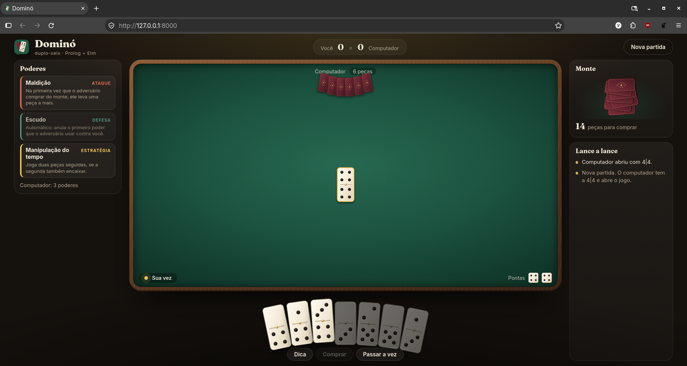
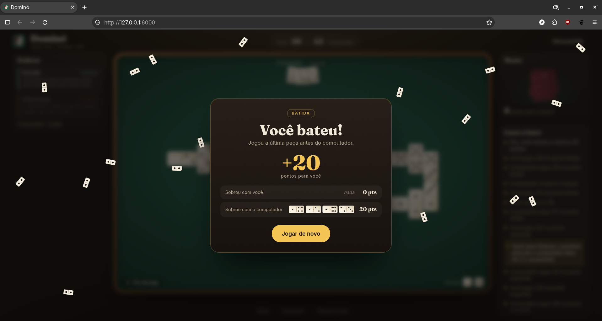

# Dominó em Prolog + Elm

## 1. Identificação

| Nome completo | Matrícula | Turma (14h/16h) | Usuário GitHub |
|---------------|-----------|-----------------|----------------|
| Julio Cesar Almeida Dourado | 211030809 | 14h | @julio-dourado |
| Patrick Anderson Carvalho dos Santos | 211030620 | 14h | @patrickacs |
| Pedro Luiz Fonseca da Silva | 231036980 | 14h | @pedroluizfo |
| Samuel Ricardo Dias da Silva | 211031495 | 14h | @SamuelRicardoDS |
| Bruno de Oliveira | 180062778 | 14h | @BrunoOLiveirax |
| Gustavo Henrique Rodrigues de Sousa | 211030783 | 14h | @GustavoHenriqueRS |
| Vitor Gabriel Gonçalves Dias | 200032364 | 14h | @VituuDias |

- **Nome do projeto:** Dominó em Prolog + Elm
- **Nome do grupo:** Grupo X
- **Repositório:** https://github.com/julio-dourado/project-paradigms
- **Commit ou tag entregue:** [hash do commit final ou tag]
- **Ponto de partida:** outro jogo conhecido
- **Slides da apresentação oral:** `docs/apresentacao.pptx`

## 2. Resumo

Jogo de dominó duplo-seis no navegador, em que uma pessoa joga contra o computador. O **Prolog** guarda todas as regras: distribuir as peças, dizer quais jogadas valem, comprar, passar, detectar batida e jogo trancado, escolher a jogada do computador e sugerir uma dica. O **Elm** desenha a mesa e controla a partida na tela, e um backend fino em Python/FastAPI liga os dois. O jogo está no ar em https://domino.144-22-232-63.sslip.io.

Além do dominó comum, o jogo tem **poderes especiais**: cada jogador recebe 3 poderes diferentes no começo da partida, cada um vale uma vez, e dá para usar um por turno, antes de jogar. São nove: Congelamento, Maldição, Sobrecarga, Escudo, Recuperação, Teletransporte, Manipulação do tempo, Troca e Chamas. As regras deles ficam num módulo Prolog separado, `powers`, que usa o `domino` sem alterá-lo. Na tela, os poderes aparecem num cartão à esquerda, a mesa fica no centro, e o monte e o lance a lance ficam à direita.

### 2.1 Capturas do Jogo

 



## 3. Como executar

**Requisitos** (com as versões que o grupo usou):

- SWI-Prolog 9 ou mais novo (o CI usa a imagem `swipl:10.0.2`, `.github/workflows/ci.yml:23`)
- Python 3.10 ou mais novo
- Elm 0.19.1 (com Node: `npm install -g elm@0.19.1-6`)
- `uv`, só para o alvo `make validar`

**Instalação e execução:**

```sh
make install     # cria backend/.venv com FastAPI e janus
make build       # compila o Elm: o jogo (build/main.js) e a vitrine (build/preview.js)
make run         # http://localhost:8000 (jogo) e http://localhost:8000/docs (API)
```

`make preview` abre a vitrine do visual, que não precisa do backend.

Com Docker, a imagem completa (tela + API + Prolog):

```sh
docker build -t domino .
docker run --rm -p 8000:8000 domino
```

O jogo também está no ar em https://domino.144-22-232-63.sslip.io (detalhes em `deploy/README.md`).

**Testes:**

```sh
make test        # 67 testes plunit do Prolog + 49 testes da API
make validar     # confere a forma deste relatório
```

**Testado em:** Linux (Ubuntu 24.04 no GitHub Actions, `.github/workflows/ci.yml:22`); Navegador: Firefox e Chrome.

## 4. Arquitetura

```
Navegador (Elm)  <--HTTP/JSON-->  FastAPI (Python)  <--janus-->  SWI-Prolog
 frontend/src/                     backend/app/                  backend/prolog/
```

| Parte  | Responsabilidade | Arquivos principais |
|--------|------------------|---------------------|
| Prolog | Todas as regras do jogo, os poderes e a decisão do computador | `backend/prolog/domino.pl` (dominó comum) e `backend/prolog/powers.pl` (poderes, compra obrigatória e vez do computador) |
| Elm | Estado da tela, turnos, desenho da mesa e comunicação com a API | `frontend/src/Main.elm`, `frontend/src/Api.elm`, `frontend/src/View.elm`, `frontend/src/Domino.elm` |
| Python | Só integração: rotas HTTP, validação do estado recebido e uma função por predicado via janus. | `backend/app/main.py`, `backend/app/prolog.py` |

O servidor **não guarda estado**. O navegador manda a partida inteira em cada requisição e recebe a partida nova. Isso tem três vantagens:

1. O Prolog trabalha só com termos que chegam como argumento, sem `assert`/`retract` nem variáveis globais.
2. No Elm o estado também é um valor imutável no `Model`, então os dois lados pensam da mesma forma: `estado novo = f(estado antigo, ação)`.
3. Reiniciar o servidor não perde nenhuma partida, e vários jogadores podem usar o mesmo backend.

`View.elm` não importa `Main` nem `Domino` (`frontend/src/View.elm:9`): recebe tudo pronto em `View.Props` (`frontend/src/View.elm:98`) e devolve as ações pelas funções de `View.Config` (`frontend/src/View.elm:121`). Com isso o visual pôde ser feito e testado na vitrine antes de o restante da tela existir.

## 5. Parte em Prolog

As regras estão organizadas em dois módulos Prolog: `domino`, com 22 predicados exportados para as regras tradicionais (`backend/prolog/domino.pl:19`), e `powers`, com os poderes especiais (`backend/prolog/powers.pl:38`). Peça é lista `[A,B]` com `A =< B`, e lado e turno são átomos, porque o janus não converte termos compostos (`backend/prolog/domino.pl:4`).

### 5.1 Predicados principais

| Predicado | Local | O que faz |
|-----------|-------|-----------|
| `all_pieces(-Pieces)` | `backend/prolog/domino.pl:51` | Gera as 28 peças do duplo-seis com `findall/3`. |
| `deal(+Shuffled, -Player, -Opponent, -Boneyard)` | `backend/prolog/domino.pl:64` | Dá 7 peças a cada jogador e deixa 14 no monte, só com `length/2` e `append/3`. |
| `starter(+Player, +Opponent, -Turn, -Piece)` | `backend/prolog/domino.pl:90` | Decide quem começa e com qual peça (maior bucha; sem bucha, a maior soma). |
| `new_game(-Player, -Opponent, -Boneyard, -Turn, -StartPiece)` | `backend/prolog/domino.pl:100` | Monta uma partida completa. |
| `table_ends(+Table, -Left, -Right)` | `backend/prolog/domino.pl:114` | Pontas da mesa por unificação; falha com a mesa vazia. |
| `fits(+Piece, +Table, ?Side)` | `backend/prolog/domino.pl:122` | Verdadeiro se a peça encaixa no lado; com `Side` livre, enumera os lados. |
| `valid_moves(+Hand, +Table, -Moves)` | `backend/prolog/domino.pl:134` | Todas as jogadas `[Peça, Lado]`. |
| `play_piece(+Piece, +Side, +Hand, +Table, -NewHand, -NewTable)` | `backend/prolog/domino.pl:162` | Tira a peça da mão, vira se preciso e põe na mesa. Falha se a jogada não vale. |
| `draw_until_playable(+Hand, +Table, +Boneyard, -NewHand, -NewBoneyard, -Drawn)` | `backend/prolog/domino.pl:182` | Compra até ter jogada ou o monte acabar. |
| `can_pass(+Hand, +Table, +Boneyard)` | `backend/prolog/domino.pl:191` | Só passa quem não tem jogada nem o que comprar. |
| `game_over(+Player, +Opponent, +Table, +Boneyard, -Winner, -Points)` | `backend/prolog/domino.pl:232` | Batida ou jogo trancado, com vencedor e pontos. Falha enquanto há jogo. |
| `move_score(+Move, +Hand, +Table, -Score)` | `backend/prolog/domino.pl:262` | Nota da jogada: pontos da peça, +5 se bucha, +2 por peça que continua jogável. |
| `choose_move(+Hand, +Table, -Move)` | `backend/prolog/domino.pl:279` | Jogada do computador: a de maior nota. |
| `hint(+Hand, +Table, +Boneyard, -Hint)` | `backend/prolog/domino.pl:300` | Dica: `[Peça, Lado]`, `draw` ou `pass`. |

### Poderes especiais — predicados do módulo `powers`

O módulo `backend/prolog/powers.pl` mantém o estado da partida como uma lista imutável de oito campos: mãos, mesa, monte, poderes restantes de cada lado, efeitos ativos e turno. Os predicados principais são:

| Predicado | Local | O que faz |
|-----------|-------|-----------|
| `all_powers(-Powers)` / `power_kind(?Power, ?Kind)` | `backend/prolog/powers.pl:68` | Enumera os nove poderes e classifica cada um como ataque, defesa ou estratégia. |
| `powers_per_player(-N)` / `deal_powers(-Mine, -Theirs)` | `backend/prolog/powers.pl:71` / `:91` | Define três poderes por jogador e os distribui sem repetição entre os dois. |
| `initial_state(+Player, +Opponent, +Boneyard, +Turn, -State)` | `backend/prolog/powers.pl:101` | Cria o estado estendido da partida, incluindo poderes e efeitos. |
| `legal_moves(+Who, +State, -Moves)` | `backend/prolog/powers.pl:164` | Calcula jogadas legais respeitando Congelamento e Chamas. |
| `must_draw(+Who, +State)` / `can_pass_now(+Who, +State)` | `backend/prolog/powers.pl:187` / `:196` | Decide se é obrigatório comprar ou se já é permitido passar. |
| `draw_one(+Who, +State, -NewState, -Piece)` | `backend/prolog/powers.pl:203` | Compra uma peça obrigatória e atualiza o estado da Maldição. |
| `play(+Who, +Piece, +Side, +State, -NewState)` / `pass(+Who, +State, -NewState)` | `backend/prolog/powers.pl:232` / `:256` | Valida a jogada ou a passagem, aplica efeitos e atualiza o turno. |
| `can_use(+Who, +Power, +Arg, +State)` | `backend/prolog/powers.pl:288` | Verifica turno, posse do poder, limite de uso e validade do argumento. |
| `use_power(+Who, +Power, +Arg, +State, -NewState, -Outcome)` | `backend/prolog/powers.pl:332` | Consome um poder, resolve ataque/defesa ou efeito próprio e devolve o resultado. |
| `revealed_pieces(+Who, +State, -Pieces)` | `backend/prolog/powers.pl:399` | Retorna as buchas reveladas que ainda estão na mão do alvo. |
| `hint_for(+Who, +State, -Hint)` / `computer_turn(+Who, +State, -NewState, -Events)` | `backend/prolog/powers.pl:416` / `:439` | Sugere ação respeitando os efeitos ou executa o turno completo do computador. |

Pela regra implementada, os poderes são usados depois da primeira peça da partida e antes da jogada normal; no máximo um pode ser usado por turno. O Escudo é passivo: consome-se automaticamente ao bloquear um ataque.

| Poder | Efeito implementado |
|---|---|
| Congelamento (`freeze`) | Bloqueia para o adversário uma das pontas da mesa durante o turno dele. |
| Maldição (`curse`) | Na primeira compra obrigatória do alvo, cria a obrigação de comprar mais uma peça; não se acumula com Maldição ou compra extra já pendente. |
| Sobrecarga (`overload`) | Revela as buchas que o adversário tem na mão; as peças deixam de aparecer na lista revelada quando saem da mão. |
| Escudo (`shield`) | Anula automaticamente um ataque e é consumido, assim como o poder de ataque usado. |
| Recuperação (`recovery`) | Troca a peça de maior soma da própria mão por uma peça do monte. |
| Teletransporte (`teleport`) | Remove Congelamento e Chamas que estejam afetando o próprio jogador. |
| Manipulação do tempo (`time`) | Mantém a vez após uma jogada se ainda houver outra jogada legal; permite jogar uma segunda peça. |
| Troca (`swap`) | Troca uma peça escolhida da própria mão por uma do monte. |
| Chamas (`flames`) | Se o adversário tiver uma jogada legal com o número escolhido, fica obrigado a jogar uma dessas; caso contrário, a restrição não impede a jogada. |

O predicado `legal_moves/3` aplica Congelamento e Chamas às jogadas legais do dominó. `must_draw/2`, `draw_one/4` e `end_turn/3` tratam a compra obrigatória, a compra extra da Maldição e o vencimento de efeitos por turno. A API expõe o uso por `POST /power`, calcula as jogadas e poderes utilizáveis para a interface, e devolve eventos com o resultado da ação.

**Ressalva do computador:** a seleção automática de poderes (`choose_power/4`) tem candidatos para Teletransporte, Recuperação, Manipulação do tempo, Congelamento, Chamas e Maldição, mas não para Sobrecarga nem Troca. Esses dois poderes estão implementados e disponíveis para o jogador, porém o computador não os usa atualmente.

### 5.2 Conceitos do paradigma lógico utilizados

- [x] Fatos e regras como base de conhecimento: `next_turn/2` (`backend/prolog/domino.pl:196`) e `blocked_result/5` (`backend/prolog/domino.pl:244`) são só fatos; `domino_out/1` (`backend/prolog/domino.pl:206`) é um fato sobre a mão vazia.
- [x] Unificação e casamento de padrões: `table_ends/3` casa a primeira e a última peça (`backend/prolog/domino.pl:114`); `piece_rank/2` reconhece a bucha pelo padrão `[A,A]` (`backend/prolog/domino.pl:79`); `place/4` escolhe a cláusula pelo átomo `left`/`right` (`backend/prolog/domino.pl:169`); `game_over/6` reconhece a batida pela mão `[]` (`backend/prolog/domino.pl:232`).
- [x] Recursão (inclusive sobre listas): `draw_until_playable/6` compra uma peça por vez e acumula a lista do que foi comprado (`backend/prolog/domino.pl:182`).
- [x] Backtracking e múltiplas soluções: `fits/3` tem uma cláusula por lado e, com `Side` livre, devolve os dois por backtracking (`backend/prolog/domino.pl:122`); `starter/4` percorre as duas mãos com `member/2` (`backend/prolog/domino.pl:92`).
- [x] `findall/3`, `bagof/3`, `setof/3` ou similares: `all_pieces/1` (`backend/prolog/domino.pl:52`), `valid_moves/3` (`backend/prolog/domino.pl:135`), `hand_points/2` (`backend/prolog/domino.pl:219`) e `choose_move/3` (`backend/prolog/domino.pl:282`).
- [x] Corte (`!`) ou negação (`\+`), e por que foram necessários: em `piece_rank/2` o corte impede que uma bucha caia também na regra de peça comum (`backend/prolog/domino.pl:79`); em `game_over/6` separa batida de jogo trancado (`backend/prolog/domino.pl:232`); em `play_piece/6` evita reprocessar a jogada depois que o lado foi confirmado (`backend/prolog/domino.pl:165`); em `hint/4` deixa só a primeira dica que vale (`backend/prolog/domino.pl:300`).
- [ ] Programação por restrições (CLP(FD) ou outra): não usada.
- [ ] Predicados de ordem superior (`maplist`, `foldl`, `include`): não usados; as iterações são feitas com `findall/3`.
- [x] Outro: falha como resposta. `game_over/6` falha enquanto há jogo, `choose_move/3` falha sem jogada (`backend/prolog/domino.pl:281`) e `can_pass/3` só vale sem jogada e sem monte (`backend/prolog/domino.pl:191`); a API usa a falha diretamente para recusar a ação. `keysort/2` com notas negativas escolhe a melhor jogada e mantém a ordem nos empates (`backend/prolog/domino.pl:287`).

### 5.3 Trecho em destaque

`backend/prolog/domino.pl:122` a `backend/prolog/domino.pl:137`:

```prolog
fits(_, [], right).
fits(Piece, Table, left) :-
    table_ends(Table, Left, _),
    memberchk(Left, Piece).
fits(Piece, Table, right) :-
    table_ends(Table, _, Right),
    memberchk(Right, Piece).

valid_moves(Hand, Table, Moves) :-
    findall([Piece, Side],
            ( member(Piece, Hand), fits(Piece, Table, Side) ),
            Moves).
```

`fits/3` não diz como procurar uma jogada: declara quando uma peça encaixa num lado. Cada cláusula é uma regra do jogo (mesa vazia aceita qualquer peça; à esquerda, a peça precisa ter o número da ponta esquerda; à direita, o da ponta direita). Por isso o mesmo predicado responde a duas perguntas: com `Side` ligado, "a `[2,4]` encaixa na direita?"; com `Side` livre, "em que lados ela encaixa?", e o Prolog devolve um lado por backtracking.

`valid_moves/3` é só a segunda pergunta feita para cada peça da mão: `member/2` gera as peças, `fits/3` gera os lados, e o `findall/3` recolhe todas as combinações. Não há laço, índice nem lista auxiliar; a busca vem do backtracking. A mesma descrição alimenta `playable_pieces/3`, `can_pass/3`, `blocked/4`, `choose_move/3` e `hint/4`, então a regra do encaixe existe em um lugar só.


## 6. Parte em Elm

### 6.1 Modelo e mensagens

`frontend/src/Main.elm:41`, `frontend/src/Main.elm:64` e `frontend/src/Main.elm:128`:

```elm
type alias Model =
    { api : String
    , state : Api.State
    , phase : Phase
    , opening : Maybe Piece
    , selected : Maybe Piece
    , hint : Maybe Hint
    , lastPlayed : Maybe Piece
    , log : List String
    , score : { player : Int, opponent : Int }
    , error : Maybe String
    , busy : Bool
    , game : Int
    , retries : Int
    }

type Phase
    = Starting
    | Playing
    | Over Winner Int

type Msg
    = Select (Maybe Piece)
    | PlayPiece Piece End
    | DrawFromBoneyard
    | PassTurn
    | AskHint
    | NewGame
    | OpponentThinks Int
    | GotGame Int (Result Api.Error Api.Reply)
    | GotPlay Int Api.Action (Result Api.Error Api.Reply)
    | GotOpponent Int (Result Api.Error Api.Reply)
    | GotHint Int (Result Api.Error Hint)
```

Tipos do domínio em `frontend/src/View.elm:51` a `frontend/src/View.elm:84` e `frontend/src/Api.elm:61` a `frontend/src/Api.elm:101`:

- `Phase` em vez de `Bool`s soltos: a partida está começando, em andamento ou acabou, e só `Over` carrega vencedor e pontos. Não existe "acabou sem vencedor".
- `End = LeftEnd | RightEnd`, `Winner = PlayerWins | OpponentWins | Draw` e `Turn = Player | Opponent` substituem as strings do JSON; um átomo inesperado é recusado no decoder (`frontend/src/Api.elm:270`).
- `Hint = PlayHint Piece End | DrawHint | PassHint` e `Action = Place Piece End | Draw | Pass` espelham o formato do `hint/4`: uma jogada sempre tem peça e ponta juntas.
- `Maybe` para o que pode faltar: peça selecionada, dica, peça de abertura, última peça jogada e mensagem de erro.
- `Result Api.Error ...` em toda resposta HTTP, com `Error = Network | Timeout | Rejected (Maybe String) | ServerError Int | BadJson String` (`frontend/src/Api.elm:96`), para a tela dar uma mensagem diferente em cada caso (`frontend/src/Api.elm:155`).
- O `Int` em `GotGame`, `GotPlay`, `GotOpponent` e `GotHint` é o número da partida: resposta de uma partida antiga é descartada (`frontend/src/Main.elm:187`).

### 6.2 Conceitos do paradigma funcional utilizados

- [x] Arquitetura Elm (Model, update, view): `main` em `frontend/src/Main.elm:27`, `update` em `frontend/src/Main.elm:142`, `view` em `frontend/src/Main.elm:519`.
- [x] Custom types e `case` exaustivo: `update` trata cada `Msg` (`frontend/src/Main.elm:144`); `settle` decide entre fim de jogo e próxima vez pelo `case reply.outcome` (`frontend/src/Main.elm:294`).
- [x] `Maybe` e `Result` no lugar de null e exceções: as funções de `Api` devolvem `Result Error ...` (`frontend/src/Api.elm:108` a `frontend/src/Api.elm:126`); `Domino.place` devolve `Maybe Table` quando a peça não encaixa (`frontend/src/Domino.elm:129`).
- [x] Funções de ordem superior e aplicação parcial: `View.Config` é um record de funções que geram mensagens (`frontend/src/View.elm:121`, preenchido em `frontend/src/Main.elm:521`); `Api.newGame model.api (GotGame game)` aplica parcialmente o construtor `GotGame` (`frontend/src/Main.elm:120`); `List.filter` em `frontend/src/View.elm:1274`.
- [x] Composição (`|>`, `>>`): decoders encadeados com `|>` e `Decode.andThen` (`frontend/src/Api.elm:232`); `Process.sleep ms |> Task.perform` (`frontend/src/Main.elm:310`).
- [x] Decoders e encoders JSON: `reply`, `stateDecoder`, `piece`, `hintDecoder`, `outcome`, `atom` e `optional` (`frontend/src/Api.elm:209` a `frontend/src/Api.elm:297`); `encodeState`, `encodePiece` e `encodeAction` (`frontend/src/Api.elm:304` a `frontend/src/Api.elm:349`).
- [x] Comandos e subscriptions (efeitos controlados): HTTP só por `Cmd` em `Api` (`frontend/src/Api.elm:131`); a pausa de "computador pensando" é um `Cmd` com `Process.sleep` (`frontend/src/Main.elm:308`). Não há subscriptions.
- [x] Imutabilidade e atualização de records: `startGame` e `settle` devolvem um `Model` novo com `{ model | ... }` (`frontend/src/Main.elm:107`, `frontend/src/Main.elm:280`).
- [x] Outro: a tela é uma função pura dos dados. As peças, o monte e o logo são SVG gerados por funções em `View.elm` (`frontend/src/View.elm:1165`), sem nenhuma imagem baixada.

### 6.3 Trecho em destaque

`frontend/src/Api.elm:229` a `frontend/src/Api.elm:281`:

```elm
piece : Decoder Piece
piece =
    Decode.list Decode.int
        |> Decode.andThen
            (\xs ->
                case xs of
                    [ a, b ] ->
                        Decode.succeed ( a, b )

                    _ ->
                        Decode.fail "peça precisa ter dois números"
            )


hintDecoder : Decoder Hint
hintDecoder =
    Decode.oneOf
        [ Decode.map2 PlayHint (Decode.index 0 piece) (Decode.index 1 end)
        , atom [ ( "draw", DrawHint ), ( "pass", PassHint ) ]
        ]


atom : List ( String, a ) -> Decoder a
atom options =
    Decode.string
        |> Decode.andThen
            (\s ->
                case List.filter (\( name, _ ) -> name == s) options of
                    ( _, value ) :: _ ->
                        Decode.succeed value

                    [] ->
                        Decode.fail ("átomo inesperado: " ++ s)
            )
```

O Prolog devolve a dica em três formatos diferentes: `[[2,4],"right"]`, `"draw"` ou `"pass"`. Em vez de guardar isso como JSON solto ou string, o decoder converte a resposta num valor de `Hint`, e qualquer coisa fora do contrato vira `Err (BadJson ...)` na fronteira, antes de chegar ao `update`. A partir daí o resto do programa não precisa conferir nada: o `case` sobre `Hint` é exaustivo, e o compilador obriga a tratar as três possibilidades.

Os decoders são pequenos e se combinam: `piece` aceita só listas de exatamente dois inteiros, `atom` transforma qualquer átomo do Prolog num custom type a partir de uma tabela, e `hintDecoder` junta os dois com `oneOf`. O mesmo `atom` é reutilizado para `Turn`, `End` e `Winner` (`frontend/src/Api.elm:243` a `frontend/src/Api.elm:266`).

## 7. Integração

O janus converte listas, inteiros e átomos, mas não termos compostos; por isso peça é `[A,B]` e lado e turno são átomos. String do Python vira *string* no Prolog, então os lados e o turno entram na consulta por `atom_string/2` (`backend/app/prolog.py:89`). Um `threading.Lock` deixa só uma consulta Prolog rodar por vez, porque o FastAPI atende em várias threads (`backend/app/prolog.py:34`).

As rotas respondem na raiz (`/new-game`) e em `/api` (`/api/new-game`). As que mudam a partida respondem `{"state", "result", "event", "game_over"}`; `result` é `null` enquanto há jogo e, no fim, `{"winner", "points"}`.

| Rota / chamada | Entrada | Saída | Predicado Prolog |
|----------------|---------|-------|------------------|
| `POST /new-game` (`backend/app/main.py:211`) | corpo vazio | `state` e `start_piece` | `new_game/5` |
| `POST /play` (`backend/app/main.py:227`) | `state` e `action`: `[[2,4],"right"]`, `"draw"` ou `"pass"` | `state`, `result`, `event`, `game_over` | `starter/4`, `play_piece/6`, `draw/4`, `can_pass/3`, `next_turn/2`, `game_over/6` |
| `POST /power` | `state`, `power`, `arg` | `can_use/4`, `use_power/6` | O jogador usa um poder, antes de jogar. `arg` é `"left"`/`"right"` (Congelamento), um número de 0 a 6 (Chamas), uma peça da mão (Troca) ou `null`. O `event.power.outcome` diz `applied`, `shielded`, `swapped` ou `revealed`. |
| `POST /opponent-move` (`backend/app/main.py:252`) | `state` | `state`, `result`, `event` (com `drawn`), `game_over` | `starter/4`, `draw_until_playable/6`, `choose_move/3`, `play_piece/6`, `game_over/6` |
| `POST /hint` (`backend/app/main.py:281`) | `state` | `hint`: `[[2,4],"right"]`, `"draw"` ou `"pass"` | `starter/4`, `hint/4` |
| `POST /draw` e `POST /pass` (`backend/app/main.py:240`, `backend/app/main.py:246`) | `state` | igual ao `/play` | atalhos para o `/play` |
| `GET /health` (`backend/app/main.py:204`) | nada | `status` | `next_turn/2` |

Erros: **400** quando a jogada não vale, **409** quando não é a vez de quem pediu ou a partida já acabou, e **422** quando o corpo não é um estado possível. A frase vem em `detail`, em português, e a tela a mostra.

Decisões:

- **Peça de saída.** Em vez de guardar a `StartPiece` no estado, a API pergunta de novo ao `starter/4` enquanto a mesa está vazia (`backend/app/main.py:149`): as mãos ainda são as do começo, então a resposta é a mesma do `new_game/5`.
- **Passar a vez segue o `can_pass/3`.** O visual libera o botão "Passar", mas o passe com jogada ou com monte é recusado com 400 (`backend/app/main.py:188`). A regra continua num lugar só.
- **Compra uma a uma para o jogador, de uma vez para o computador.** O jogador usa `draw/4` (`backend/app/main.py:175`), para a tela animar cada peça; o computador usa `draw_until_playable/6`.
- **Validação do estado.** Como o estado vem do navegador, a API confere que ele é um jogo possível: peças em ordem crescente na mão e no monte, vizinhas da mesa encostando e as 28 peças presentes uma vez só (`backend/app/main.py:66`).
- **Maldição até a primeira compra.** A Maldição não vale só para o turno seguinte: fica no alvo até a primeira compra dele. Se ele tem jogada, joga e a Maldição continua, então ela não se perde contra quem ainda tem peça para jogar. O Escudo, que é automático, anula a Maldição no lançamento e é gasto nessa hora, então quem tem Escudo nunca fica amaldiçoado. Também não dá para lançá-la em quem já está amaldiçoado.
- **Mesma origem.** O FastAPI serve a pasta `frontend/`, então o jogo e as rotas ficam no mesmo endereço, sem CORS.

## 8. Testes e validação

- **Prolog (plunit):** 137 testes em plunit, em dois arquivos. `backend/prolog/test_domino.pl` tem 67 testes, em cinco suítes: `domino` (preparação), `regras`, `fim_de_jogo`, `adversario` e `dica`. `backend/prolog/test_powers.pl` tem 70, em seis suítes: `catalogo`, `restricoes`, `maldicao`, `poderes`, `computador` e `partidas_inteiras` (partidas completas com poderes). Rodam com `make test-prolog`.
- **API (pytest):** 106 testes em pytest (`backend/tests/test_api.py` e `backend/tests/test_powers_api.py`) que passam pelas três camadas (HTTP, FastAPI, janus e o SWI-Prolog de verdade, sem dublês):
  - cada rota no caminho feliz e nos erros (jogada inválida, fora da vez, monte vazio, passe recusado);
  - abertura com a peça de saída, batida e jogo trancado;
  - computador comprando até ter jogada e passando;
  - estados inválidos recusados (422);
  - 10 partidas inteiras jogadas só pela API como a tela faz, com a dica virando a `action` do `/play`, na raiz e em `/api` (`backend/tests/test_api.py:328`), conferindo a cada lance que as 28 peças continuam lá;
  - o contrato da tela: `start_piece`, `result`, `action` e a frase em `detail`.
- **CI:** o GitHub Actions roda os testes em todo push e PR (`.github/workflows/ci.yml`).
- **Tela sem backend:** a vitrine (`frontend/src/Preview.elm`) tem 12 cenários prontos (meio de jogo, escolher a ponta, dica, sem jogada, mesa longa, vitória, derrota, empate, carregando, erro de rede etc.), e `frontend/dev/backend-falso.ps1` imita as rotas para testar o `Main.elm` sem FastAPI nem Prolog.

Casos de borda considerados:

- mesa vazia: só a peça de saída pode abrir (`backend/app/main.py:149`, `frontend/src/View.elm:1281`);
- peça que encaixa nas duas pontas: a tela pede a ponta (`frontend/src/View.elm:499`);
- monte vazio: comprar é recusado e o passe passa a valer (`backend/prolog/domino.pl:191`);
- jogo trancado com empate de pontos: `draw`, 0 pontos (`backend/prolog/domino.pl:246`);
- resposta atrasada de uma partida antiga: descartada pela tela (`frontend/src/Main.elm:187`);
- falha na vez do computador: a tela tenta de novo duas vezes antes de pedir uma partida nova (`frontend/src/Main.elm:316`);
- estado adulterado vindo do navegador: recusado com 422 (`backend/app/main.py:66`).
- Maldição: que continua depois de o alvo jogar normalmente.
- Maldição que dispara só num turno futuro.
- Maldição que não empilha, Escudo anulando a Maldição, Maldição sem monte para a compra extra.
- Congelamento e Chamas restringindo as jogadas.

Não há testes automatizados do Elm (elm-test).

## 9. Limitações e problemas conhecidos

- **`Domino.elm` não está ligado à tela.** O módulo da parte 4 (`frontend/src/Domino.elm`) existe, mas nenhum outro módulo o importa. As regras instantâneas que a tela usa para destacar peças estão duplicadas em `View.elm` (`frontend/src/View.elm:1238` a `frontend/src/View.elm:1291`), e o `Api.elm` ainda se declara provisório (`frontend/src/Api.elm:9`).
- **O navegador recebe a partida inteira, inclusive a mão do computador e a ordem do monte.** Quem abrir as ferramentas do navegador vê as peças do adversário e as próximas compras. É consequência do servidor sem estado (seção 4).
- **A vitrine copia as regras em Elm.** `frontend/src/Preview.elm` e `frontend/dev/backend-falso.ps1` repetem regras do `domino.pl` só para testar a tela; se o Prolog mudar, as cópias podem ficar desatualizadas.
- **O computador olha só uma jogada à frente.** `move_score/4` é uma nota gulosa (`backend/prolog/domino.pl:262`); não considera as peças que o jogador pode ter.
- **Botão "Passar" sempre liberado na vez do jogador.** É proposital (a regra fica no `can_pass/3`), mas o jogador só descobre que não pode passar pela mensagem de erro.
- **Sem testes do Elm.** A tela é verificada pela vitrine e pelo uso manual, não por elm-test.
- Com mais tempo: ligar o `Domino.elm` ao `Main.elm` no lugar das funções duplicadas do `View.elm`, esconder a mão do computador no servidor e adicionar elm-test aos decoders.

## 10. Contribuição de cada integrante

Levantado do histórico de commits do repositório (`git log --no-merges`; merges não contados).

| Integrante | Principais contribuições |
|------------|--------------------------|
| Vitor Gabriel Gonçalves Dias | Parte 1, Prolog: preparação. Geração das 28 peças, embaralhamento, distribuição, força da peça, quem começa e `new_game/5`, com testes; revisão dos comentários do `domino.pl` (7 commits). |
| Gustavo Henrique Rodrigues de Sousa | Parte 2, Prolog: jogadas. Pontas, peças jogáveis, jogar, comprar e passar, com testes; primeira versão do `README.md` com arquitetura e contrato de dados (2 commits). |
| Pedro Luiz Fonseca da Silva | Parte 3, Prolog: fim de jogo e adversário. Batida, jogo trancado e pontuação (`game_over/6`), jogada do computador (`choose_move/3`, `move_score/4`) e dica (`hint/4`), com testes (3 commits). |
| Bruno de Oliveira | Parte 4, Elm: modelo. Regras instantâneas em `frontend/src/Domino.elm` (1 commit). |
| Samuel Ricardo Dias da Silva | Parte 5, Elm: lógica da tela. `frontend/src/Main.elm`, `frontend/src/Api.elm` provisório e `frontend/dev/backend-falso.ps1` (3 commits). |
| Patrick Anderson Carvalho dos Santos | Parte 6, Elm: visual. `frontend/src/View.elm`, `frontend/style.css`, logo e a vitrine `frontend/src/Preview.elm` em turnos contra o computador (3 commits). |
| Julio Cesar Almeida Dourado | Parte 7, integração e documentação. Ponte janus (`backend/app/prolog.py`), API FastAPI (`backend/app/main.py`), testes da API, `Makefile`, `index.html`, Dockerfile, deploy na VM, CI e primeira versão deste relatório (15 commits). |

## 11. Fontes, código de terceiros e uso de IA

**Código reaproveitado.** Não partimos do template do Sudoku: o repositório foi iniciado do zero. Os arquivos domino.pl, powers.pl, Domino.elm, View.elm, Preview.elm, main.py e os testes foram escritos pelo grupo. Do projeto-modelo do professor aproveitamos apenas dois padrões, ambos reescritos: a ponte prolog.py como único arquivo que conhece o janus (consult e query_once) e o esqueleto da função expectJson em Api.elm. Usamos as mesmas bibliotecas do modelo: FastAPI, Pydantic, janus-swi, pytest e os pacotes elm/*.

**Referências.** Documentação do SWI-Prolog (janus, plunit, módulo `lists`), guia oficial do Elm 0.19, documentação do FastAPI e do pytest.

**Uso de ferramentas de IA.**

- **Faixa de uso no código:** auxiliar

| Ferramenta | Para que foi usada | Como o grupo verificou o resultado |
|------------|--------------------|------------------------------------|
| Claude (Anthropic) |sugeriu a divisão do trabalho e ajudou na documentação| O grupo revisou as sugestões, verificou se a divisão era adequada aos requisitos do projeto e conferiu a documentação em relação ao código e às funcionalidades implementadas. |
| Claude (Anthropic) | Aperfeiçoamento de código escrito inicialmente pelos integrantes, sugestões de organização e melhorias na implementação. | As sugestões foram avaliadas pelos integrantes e integradas somente quando estavam de acordo com os requisitos e com o funcionamento esperado do projeto. |
| Claude (Anthropic), pelo Claude Code | Em 24/11: copiar `scripts/validar_entrega.py` e `avaliacao-360/TEMPLATE.md` do modelo, adicionar o alvo `validar` ao `Makefile` e reorganizar este relatório nas 13 seções do modelo, a partir do texto que já existia. | [como o grupo conferiu] |

## 12. Apresentação oral

- **Slides:** docs/apresentacao.pptx
- **Roteiro:** 

| Parte | Duração | Quem apresenta |
|-------|:-------:|----------------|
| Contexto e objetivo | [duração] | [Nome] |
| Demonstração | [duração] | [Nome] |
| Código Prolog | [duração] | [Nome] |
| Código Elm | [duração] | [Nome] |
| Limitações e aprendizados | [duração] | [Nome] |

## 13. Reflexão sobre os paradigmas

Separar as regras em Prolog e a tela em Elm deixou cada paradigma fazer o que faz melhor. As regras do dominó viraram relações curtas e verificáveis: a busca por jogadas, a dica e o adversário saíram quase de graça do backtracking e do `findall`. `fits/3` (`backend/prolog/domino.pl:122`) é o exemplo mais claro: a mesma regra serve para conferir uma jogada e para gerar todas, e `can_pass/3`, `blocked/4`, `choose_move/3` e `hint/4` são construídos em cima dela. A falha também virou resposta: a API não precisa de códigos de erro do Prolog, porque `play_piece/6` falhar já significa "jogada inválida". O que ficou mais difícil foi o que não é lógico: o janus não passa termos compostos, o que obrigou a representar tudo com listas e átomos e a converter strings com `atom_string/2`.

Na tela, os tipos algébricos e as funções puras permitiram construir e testar o visual sozinho, só com dados: `View.elm` recebe um `Props` e devolve mensagens por `Config`, sem saber de onde vêm os dados, e por isso a vitrine e o jogo de verdade usam a mesma `view`. Os decoders de `Api.elm` concentram na fronteira tudo o que pode dar errado com o JSON, e depois dela um `Hint` ou um `Winner` só pode ser um dos valores do tipo. A integração ficou simples porque o formato dos dados foi combinado desde o começo, e o backend sem estado manteve as duas pontas pensando da mesma forma: uma partida é um valor, e cada jogada produz um valor novo.
